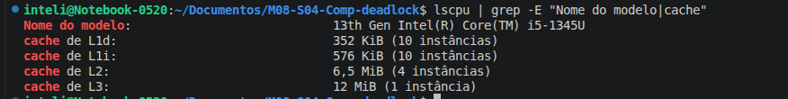
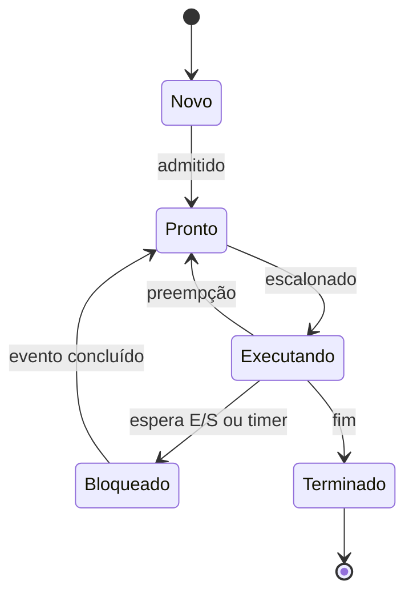
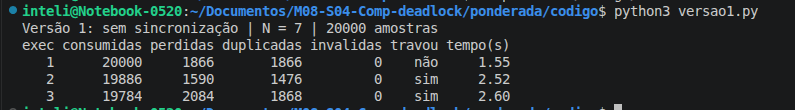
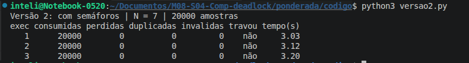
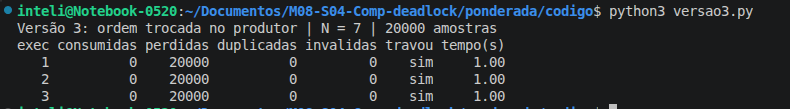
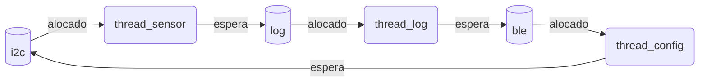

**Ana Júlia Rodrigues Ribeiro | D1 = 3 | D2 = 4 | N = 7**

## Parâmetros individuais

Ana (3) + Júlia (5) + Rodrigues (9) + Ribeiro (7) = 24 letras. D1 = 3 e D2 = 4.

| Parâmetro | Fórmula | Valor |
|---|---|---|
| Instruções por amostra (IC) | 100.000 + 20.000 × D2 | 180.000 |
| Taxa de falta na cache L1 do SoC (m) | 3% + 0,5% × D1 | 4,5% |
| Tamanho do buffer de amostras (N) | 3 + (D2 mod 5) | 7 |

## PARTE A - Problema Técnico

### A1. Arquitetura e memória: qual processador vai na pulseira?

**1. Calcule o tempo para processar uma amostra na Plataforma H, usando o seu IC. Ela atende os 5 ms?**

A memória da Plataforma H não tem cache e responde em 1 ciclo, então o CPI de 1,5 já é o valor final.

```text
Tempo = (IC × CPI) / clock
Tempo = (180.000 × 1,5) / (48 × 10^6 Hz)
Tempo = 270.000 / 48.000.000 = 5,625 ms
```

**Não atende:** 5,625 ms > 5 ms, um estouro de 0,625 ms.

**2. Para a Plataforma V, calcule o tempo médio de acesso à memória (AMAT) e o CPI efetivo, usando a sua taxa de falta m. Considere CPI efetivo = 1,0 + (acessos por instrução × m × penalidade). Calcule o tempo por amostra e o pior caso, somando o atraso do sistema operacional. Ela atende os 5 ms?**

```text
AMAT = tempo de acerto + (m × penalidade)
AMAT = 1 + (0,045 × 120) = 1 + 5,4 = 6,4 ciclos

CPI efetivo = 1,0 + (1,3 × 0,045 × 120) = 1,0 + 7,02 = 8,02

Tempo por amostra = (180.000 × 8,02) / (1,2 × 10^9 Hz)
Tempo por amostra = 1.443.600 / 1.200.000.000 = 1,203 ms

Pior caso = 1,203 ms + 3 ms = 4,203 ms
```

**Atende:** 4,203 ms < 5 ms, com folga de 0,797 ms.

Essa folga depende de m continuar em 4,5%, porque o cálculo soma o pior caso do sistema operacional a um tempo de CPU médio. O limite é 2 ms de CPU, ou CPI efetivo de 13,33, o que corresponde a m ≈ 7,9%. Uma amostra com taxa de falta acima disso estoura os 5 ms no pior caso do Linux.

**3. O time oferece um acelerador DSP para a Plataforma H que executa o filtro 5 vezes mais rápido. O filtro é 60% do tempo de processamento. Use a Lei de Amdahl para calcular o speedup global e o novo tempo por amostra. Agora atende?**

```text
Speedup global = 1 / ((1 - F) + F / S)
Speedup global = 1 / (0,4 + 0,6 / 5)
Speedup global = 1 / (0,4 + 0,12) = 1 / 0,52 ≈ 1,923

T' = 5,625 ms / 1,923 = 2,925 ms
```

**Agora atende:** 2,925 ms < 5 ms, com folga de 2,075 ms.

**4. Em até cinco linhas: por que a Plataforma V precisa de cache e a H funciona sem? Use a ideia de gargalo de Von Neumann.**

A V roda a 1,2 GHz e busca instruções e dados pelo mesmo caminho até uma DRAM externa lenta: é o gargalo de Von Neumann. Sem cache, com 120 ciclos por acesso, o CPI iria a 1 + 1,3 × 120 = 157. A H é Harvard, com caminhos separados, e a 48 MHz sua SRAM responde em 1 ciclo, sem diferença de velocidade para compensar.

**5. Evidência da sua máquina. Cole o print das caches do seu computador. A sua L1 é dividida em instruções e dados? Então o seu computador é Von Neumann ou Harvard? Justifique.**



Sim, a L1 é dividida em L1d (dados) e L1i (instruções). Os valores de 352 KiB e 576 KiB são totais somados entre as 10 instâncias de cada cache, não o tamanho de uma L1. Como o processador é híbrido, as instâncias não são iguais: L1d = 2 × 48K + 8 × 32K = 352K e L1i = 2 × 32K + 8 × 64K = 576K, com 2 núcleos P e 8 núcleos E. A coluna ONE-SIZE de `lscpu -C` mostra só o valor do núcleo P. Essa saída também mostra o tipo de cada nível, com L2 e L3 unificadas:

```text
NAME ONE-SIZE ALL-SIZE WAYS TYPE        LEVEL  SETS PHY-LINE COHERENCY-SIZE
L1d       48K     352K   12 Data            1    64        1             64
L1i       32K     576K    8 Instruction     1    64        1             64
L2       1,3M     6,5M   10 Unified         2  2048        1             64
L3        12M      12M   12 Unified         3 16384        1             64
```

O computador é **Von Neumann do ponto de vista do programa**, porque instruções e dados ficam na mesma RAM, no mesmo espaço de endereços. A separação existe só no nível da L1, o que se chama **Harvard modificada**: o núcleo busca instrução e dado ao mesmo tempo sem disputar a mesma cache, e isso alivia o gargalo sem deixar de ser uma máquina de programa armazenado.

### A2. Pipeline: o loop do filtro

Numeração usada: I1 `lw x5`, I2 `add x6`, I3 `lw x7`, I4 `sub x6`, I5 `sw x6`, I6 `addi x10`, I7 `addi x11`.

**1. Liste as dependências de dados (RAW) do trecho: qual instrução depende de qual, por qual registrador.**

Dentro do trecho:

| Instrução | Depende de | Registrador |
|---|---|---|
| I2 (`add`) | I1 (`lw`) | x5 |
| I4 (`sub`) | I3 (`lw`) | x7 |
| I4 (`sub`) | I2 (`add`) | x6 |
| I5 (`sw`) | I4 (`sub`) | x6 |

Entre iterações do laço, que não geram bolha dentro do trecho:

| Instrução | Depende de | Registrador |
|---|---|---|
| I1 da próxima iteração | I6 | x10 |
| I3 da próxima iteração | I7 | x11 |
| I2 da próxima iteração | I4 | x6 |

**2. Sem forwarding: desenhe o diagrama do pipeline ciclo a ciclo e diga quantos ciclos o trecho leva do primeiro IF ao último WB.**

Legenda: `st` é um ciclo de parada. O banco de registradores escreve na primeira metade do ciclo e lê na segunda, então uma instrução pode fazer ID no mesmo ciclo do WB de quem produz o valor. `st` logo depois de `IF` representa a instrução retida em ID. Quando a instrução seguinte também espera, seu `IF` aparece só no último ciclo da espera, embora ela já tenha sido buscada e fique retida. A convenção não muda os totais.

| | c1 | c2 | c3 | c4 | c5 | c6 | c7 | c8 | c9 | c10 | c11 | c12 | c13 | c14 | c15 | c16 | c17 |
|---|---|---|---|---|---|---|---|---|---|---|---|---|---|---|---|---|---|
| I1 lw x5 | IF | ID | EX | ME | WB | | | | | | | | | | | | |
| I2 add x6 | | IF | st | st | ID | EX | ME | WB | | | | | | | | | |
| I3 lw x7 | | | | | IF | ID | EX | ME | WB | | | | | | | | |
| I4 sub x6 | | | | | | IF | st | st | ID | EX | ME | WB | | | | | |
| I5 sw x6 | | | | | | | | | IF | st | st | ID | EX | ME | WB | | |
| I6 addi x10 | | | | | | | | | | | | IF | ID | EX | ME | WB | |
| I7 addi x11 | | | | | | | | | | | | | IF | ID | EX | ME | WB |

**Total: 17 ciclos.** São 7 instruções + 4 ciclos para esvaziar o pipeline + 6 paradas (2 para x5, 2 para x7 e 2 para x6 entre I4 e I5).

**3. Com forwarding: mesmo diagrama e total. Qual dependência continua causando bolha mesmo com forwarding, e por quê?**

| | c1 | c2 | c3 | c4 | c5 | c6 | c7 | c8 | c9 | c10 | c11 | c12 | c13 |
|---|---|---|---|---|---|---|---|---|---|---|---|---|---|
| I1 lw x5 | IF | ID | EX | ME | WB | | | | | | | | |
| I2 add x6 | | IF | st | ID | EX | ME | WB | | | | | | |
| I3 lw x7 | | | | IF | ID | EX | ME | WB | | | | | |
| I4 sub x6 | | | | | IF | st | ID | EX | ME | WB | | | |
| I5 sw x6 | | | | | | | IF | ID | EX | ME | WB | | |
| I6 addi x10 | | | | | | | | IF | ID | EX | ME | WB | |
| I7 addi x11 | | | | | | | | | IF | ID | EX | ME | WB |

**Total: 13 ciclos** (7 + 4 + 2 paradas).

Continuam causando bolha as duas dependências **load-use**: I1 → I2 (x5) e I3 → I4 (x7). O `lw` só tem o dado no fim do estágio MEM, mas a instrução seguinte precisaria dele no início do EX, que ocorre nesse mesmo ciclo. O forwarding leva um valor para a frente, nunca para trás no tempo, então é preciso esperar 1 ciclo. Já a dependência I4 → I5 (x6) se resolve sem parada, porque o resultado do `sub` existe ao fim do EX. A I2 → I4 (x6) também não para: com a bolha, o `sub` faz ID no ciclo 7, junto do WB do `add`, e lê o valor pelo banco de registradores.

**4. Reordene as instruções, sem mudar o resultado, para eliminar todas as bolhas com forwarding. Mostre a nova ordem e o novo total de ciclos.**

Basta subir o `lw x7` para antes do `add`. A troca é segura porque o `add` não usa x7 (sem RAW) nem altera x11 (sem antidependência), os dois escrevem em registradores diferentes (sem dependência de saída), e não há escrita na memória entre eles.

```asm
lw   x5, 0(x10)     # lê a amostra nova
lw   x7, 0(x11)     # lê a amostra mais antiga
add  x6, x6, x5     # soma += nova
sub  x6, x6, x7     # soma -= antiga
sw   x6, 0(x12)     # grava a soma
addi x10, x10, 4    # avança o ponteiro da nova
addi x11, x11, 4    # avança o ponteiro da antiga
```

| | c1 | c2 | c3 | c4 | c5 | c6 | c7 | c8 | c9 | c10 | c11 |
|---|---|---|---|---|---|---|---|---|---|---|---|
| lw x5 | IF | ID | EX | ME | WB | | | | | | |
| lw x7 | | IF | ID | EX | ME | WB | | | | | |
| add x6 | | | IF | ID | EX | ME | WB | | | | |
| sub x6 | | | | IF | ID | EX | ME | WB | | | |
| sw x6 | | | | | IF | ID | EX | ME | WB | | |
| addi x10 | | | | | | IF | ID | EX | ME | WB | |
| addi x11 | | | | | | | IF | ID | EX | ME | WB |

**Total: 11 ciclos**, sem nenhuma bolha. Cada `lw` agora fica a duas instruções de quem usa o seu dado, distância em que o forwarding de MEM/WB resolve.

### A3. Processos e threads: como organizar o software

**1. Proponha uma organização: quais tarefas viram threads de um mesmo processo e quais viram processos separados. Justifique com compartilhamento de memória, custo de criação e troca de contexto e isolamento de falhas.**

| Processo | Tarefas | Papel |
|---|---|---|
| Tempo real | threads de sensor, processamento e motor | caminho crítico da amostra até a vibração |
| Comunicação | BLE (log e comandos de configuração) | fala com o mundo externo |

- **Compartilhamento de memória:** sensor, processamento e motor trocam dados a cada 10 ms. Como threads, usam o mesmo buffer sem copiar nada. O BLE só precisa receber o log e entregar comandos, o que cabe em comunicação entre processos, com uma interface pequena.
- **Custo de criação e troca de contexto:** trocar entre threads do mesmo processo não exige trocar o espaço de endereçamento, então é mais barato e polui menos a cache. Isso importa dentro do limite de 5 ms, ainda mais com a penalidade de 120 ciclos por falta. O processo BLE custa mais para criar, mas é criado uma vez só, e a sua latência não é crítica.
- **Isolamento de falhas:** se o BLE falhar, o processo de tempo real continua vibrando, e o BLE pode ser reiniciado sozinho. O processo de tempo real roda com prioridade mais alta. As três threads críticas não têm isolamento entre si, mas formam uma unidade: se qualquer uma delas falhar, a função da pulseira já parou.

**2. O módulo BLE recebe dados de fora. Se alguém explorar uma falha nele, que diferença faz ele ser uma thread ou um processo separado?**

Como **thread**, ele divide o espaço de endereçamento com o caminho crítico. Quem explorar a falha pode ler as amostras, alterar o buffer, desligar o motor sem aviso ou derrubar o processo inteiro, e a pessoa fica sem vibração.

Como **processo separado**, a MMU impede o acesso direto à memória do processo de tempo real, e o BLE pode rodar sem privilégios. O atacante fica limitado à interface de comunicação, e uma queda não afeta a vibração. Isso reduz o estrago, mas não elimina o risco: o processo de tempo real precisa validar todo comando recebido, e uma falha no kernel ainda escaparia desse isolamento.

**3. Desenhe o diagrama de estados de um processo. Em qual estado a thread do sensor passa a maior parte do tempo? Por quê?**



A thread do sensor passa a maior parte do tempo em **Bloqueado**. Ela só tem trabalho uma vez a cada 10 ms: acorda, lê a amostra, entrega ao buffer e volta a dormir até o próximo período. A leitura ocupa uma fração pequena desse intervalo, e esperar bloqueada, em vez de em espera ocupada, libera a CPU para as outras tarefas.

### A4. Código com semáforos: o buffer entre o sensor e o motor

O código está em `/ponderada/codigo`, em Python 3 com `threading`, com N = 7. Cada comando roda 3 execuções de 20.000 amostras.

**Resultados**

| Versão | Execução | Consumidas | Perdidas | Duplicadas | Travou? |
|---|---|---|---|---|---|
| 1 | 1 | 20.000 | 1.866 | 1.866 | Não |
| 1 | 2 | 19.886 | 1.590 | 1.476 | Sim |
| 1 | 3 | 19.784 | 2.084 | 1.868 | Sim |
| 2 | 1 | 20.000 | 0 | 0 | Não |
| 2 | 2 | 20.000 | 0 | 0 | Não |
| 2 | 3 | 20.000 | 0 | 0 | Não |
| 3 | 1 | 0 | 20.000 | 0 | Sim |
| 3 | 2 | 0 | 20.000 | 0 | Sim |
| 3 | 3 | 0 | 20.000 | 0 | Sim |

Os números fecham: consumidas = (20.000 − perdidas) + duplicadas + inválidas, e as leituras inválidas deram 0 em todas as execuções. Na execução 2 da versão 1, 20.000 − 1.590 + 1.476 = 19.886. Essa conta é só uma checagem de consistência, porque vale por construção. Na versão 1, a coluna de perdidas conta toda amostra que o consumidor nunca recebeu: sobrescritas, deixadas no buffer ou nunca produzidas, porque o produtor é interrompido quando o consumidor termina. Por isso, numa execução que completa 20.000 leituras, como a execução 1, perdidas e duplicadas são iguais.

**Prints**







**Qual é a região crítica da versão 1, e por que ela perde ou duplica amostras?**

A região crítica é o trecho que lê, altera e escreve o contador `ocupadas`, nas duas threads, junto com o acesso à posição do buffer que esse contador autoriza. Como isso não é atômico, uma thread pode ser interrompida entre ler e escrever, e a outra escrita some:

1. O contador vale 3. O produtor lê 3 e é interrompido.
2. O consumidor lê 3, retira uma amostra e escreve 2.
3. O produtor volta e escreve 4. A saída do consumidor foi apagada.

Agora o contador diz 4, mas há 3 amostras no buffer. Com o contador **acima** do real, o consumidor lê uma posição que já tinha lido, o que **duplica** a amostra. Na ordem inversa, o contador fica **abaixo** do real, o produtor acha que há vaga e sobrescreve uma amostra ainda não lida, o que a **perde**. Essa é a causa principal da coluna de perdidas, que inclui também os casos descritos na tabela. Se o contador chega a 0 depois que o produtor terminou, o consumidor espera por amostras que nunca chegam, e isso é o **travamento** das execuções 2 e 3. A execução 1 não travou porque o consumidor completou as 20.000 leituras, contando as repetidas, antes de isso acontecer.

**O que cada um dos três semáforos garante na versão 2?**

- **`vazio` (começa em 7):** conta as posições livres. O produtor dorme com o buffer cheio, então nunca sobrescreve uma amostra não lida. Isso elimina as perdas.
- **`cheio` (começa em 0):** conta as amostras disponíveis. O consumidor dorme com o buffer vazio, então nunca lê a mesma posição duas vezes. Isso elimina as duplicações.
- **`mutex` (começa em 1):** só uma thread por vez fica na região crítica. O `time.sleep(0)` continua no mesmo ponto da versão 1, mas a outra thread não entra enquanto o mutex estiver ocupado, então a interrupção se torna inofensiva.

Além disso, as esperas deixam de consumir CPU, porque a thread dorme no semáforo em vez de ficar testando o contador.

**O que aconteceu na versão 3, e por quê?**

As três execuções travaram em deadlock, sem nenhuma amostra consumida, e o consumidor encerrou após o limite de 1 s. Uma inspeção do estado no instante do travamento, feita com instrumentação temporária que não faz parte do código entregue, mostrou `ocupadas = 7`, `vazio = 0`, `mutex = 0`, `cheio = 6` e o produtor ainda vivo.

Isso mostra a sequência: o produtor encheu as 7 posições e, na amostra seguinte, fez `wait(mutex)` com sucesso e dormiu em `wait(vazio)` **segurando o mutex**. O consumidor fez `wait(cheio)`, o que explica o 6, e dormiu em `wait(mutex)`. O produtor só acorda com um `signal(vazio)`, que só o consumidor faz, e o consumidor só avança quando o produtor soltar o mutex. É uma espera circular.

Nestas execuções, nenhuma amostra foi consumida porque o produtor soltava e pegava o mutex de novo antes de o consumidor acordar. A coluna de perdidas mostra 20.000 porque nada chegou ao consumidor: 7 amostras ficaram no buffer e as outras 19.993 nem foram produzidas. A única diferença para a versão 2 é a ordem de duas linhas.

### A5. Deadlock: a pulseira congelou

**1. Descreva uma sequência de execução que leva ao deadlock e desenhe o grafo de alocação de recursos nesse instante.**

1. `thread_sensor` faz `P(i2c)` e entra em `le_sensor()`.
2. `thread_log` faz `P(log)` e entra em `le_log()`.
3. `thread_config` faz `P(ble)` e entra em `recebe_comando()`.
4. `thread_sensor` tenta `P(log)` e bloqueia, pois `log` está com `thread_log`.
5. `thread_log` tenta `P(ble)` e bloqueia, pois `ble` está com `thread_config`.
6. `thread_config` tenta `P(i2c)` e bloqueia, pois `i2c` está com `thread_sensor`.



Como cada recurso tem uma única instância, o ciclo no grafo confirma o deadlock.

**2. Mostre como cada uma das quatro condições necessárias para o deadlock aparece nesse código.**

| Condição | Onde aparece |
|---|---|
| Exclusão mútua | `i2c`, `log` e `ble` são protegidos por semáforos: só uma thread usa cada recurso por vez. |
| Posse e espera | Cada thread fica com o primeiro recurso enquanto espera o segundo. `thread_sensor` segura `i2c` durante `P(log)`, por exemplo. |
| Sem preempção | Nada tira um recurso de quem o detém. Ele só é solto no `V()` da própria thread, e `P()` não tem tempo limite. |
| Espera circular | `thread_sensor` espera `thread_log`, que espera `thread_config`, que espera `thread_sensor`. |

**3. Proponha duas correções de tipos diferentes (por exemplo, uma de prevenção e uma de detecção e recuperação). Para cada uma, diga o que muda para quem está usando a pulseira.**

**Correção 1: prevenção, quebrando a espera circular.** Supondo que `ajusta_sensor()` só precisa do I2C e que `recebe_comando()` sempre retorna, `thread_config` solta o BLE antes de pegar o barramento. Ela nunca mais espera segurando um recurso, e a aresta que fechava o ciclo some. `thread_sensor` e `thread_log` continuam com posse e espera, mas, sem ciclo, nenhuma delas fica presa para sempre.

```c
thread_config:
  P(ble)
  recebe_comando()
  V(ble)
  P(i2c)
  ajusta_sensor()
  V(i2c)
```

*Para quem usa:* a pulseira deixa de congelar por essa causa, sem mudança no uso. A cadeia sensor → log → BLE continua, então a espera do sensor enquanto segura o I2C precisa ser medida para confirmar os 5 ms. É a correção definitiva, mas exige reescrita e novos testes.

**Correção 2: detecção e recuperação, com watchdog de hardware.** Cada thread sinaliza periodicamente que está viva. Se um sinal parar de chegar, o watchdog, que é de hardware para não travar junto, assume que houve deadlock e reinicia a pulseira, o que zera os semáforos em RAM. O reset não garante os recursos externos: o log pode ficar pela metade, e um escravo I2C pode segurar o barramento. Por isso, o boot reinicializa o I2C e valida o log. Matar só uma thread não serve, porque deixaria o recurso que ela segurava em estado inconsistente.

*Para quem usa:* o deadlock continua existindo, mas a pulseira não fica mais congelada até desligar e ligar. A pessoa perde cerca de 4 segundos de vibração, avisada por um pulso longo, e esses segundos são perigosos para quem está andando. A correção é rápida de lançar, mas trata o efeito, não a causa.

## PARTE B - Decisão como CTO

### Dilema 2: qual processador vai para a produção?

**Para:** Conselho da Tato  
**De:** Ana Júlia Rodrigues Ribeiro, CTO

**Decisão:** a Tato vai produzir com a Plataforma H com acelerador DSP, a R$ 37 por unidade.

**Por quê:** a pulseira não pode atrasar, e o que interessa é a folga no pior caso. Sem o DSP, a H reprova, com 5,625 ms. Com ele, processa uma amostra em 2,925 ms, com 2,075 ms de folga. A V fica em 4,203 ms no pior caso, com só 0,797 ms de folga, e esse número usa a taxa média de falta de 4,5%: acima de 7,9%, ela estoura os 5 ms. As duas contas são estimativas e ainda não incluem o BLE, mas a H não tem Linux nem faltas de cache para variar o tempo de uma amostra. Na V, a segurança da pessoa dependeria desses dois fatores.

**Do que abrimos mão:** da atualização pela internet. Toda correção de firmware vai exigir cabo e assistência técnica, então a correção definitiva do deadlock da A5 entra antes da produção. Quem paga é a empresa, com logística e atendimento, e quem usa a pulseira, que fica sem ela enquanto a atualização é feita. Uma pessoa com deficiência visual pode ter dificuldade para se deslocar até a assistência, e isso também pesa. Em troca, economizamos R$ 33 por unidade.

**Impacto e segurança:** quem usa ganha um produto de resposta estável. A superfície de ataque é menor, sem sistema operacional completo e sem acesso à internet. O risco é outro: uma falha no BLE não tem isolamento de processos e, uma vez descoberta, não pode ser corrigida rapidamente em toda a base. Por isso, o BLE terá uma interface mínima, com uma lista fechada de comandos validados, e o firmware passará por revisão de segurança mais rigorosa antes do lançamento.

**O que me faria mudar de ideia:** adotarei a V se, no primeiro ano em campo, surgir mais de uma falha crítica de firmware que obrigue chamar toda a base para a assistência, desde que testes em hardware real mostrem pior caso abaixo de 5 ms sob carga máxima. Também reabro a decisão se o pior caso medido da H com DSP passar de 5 ms.
